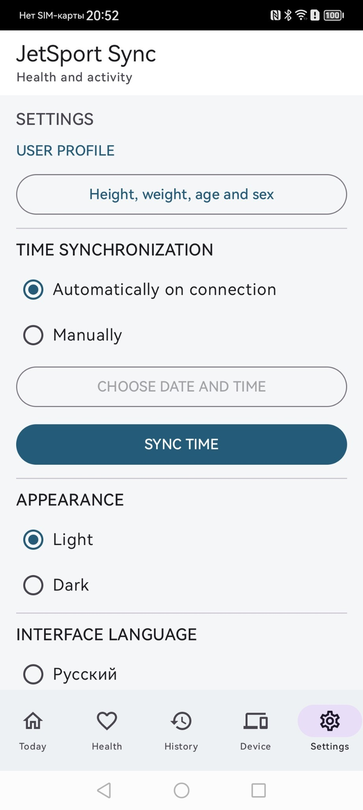

# JetSport FT-10C Sync

An Android application for local BLE communication with the JetSport FT-10C smart bracelet. The project restores basic local synchronization without depending on the manufacturer's unavailable server infrastructure.

## Current status

**Release candidate: v1.0.0**, promoted from the user-tested `0.6.0.26` checkpoint.

- Bracelet tested: JetSport FT-10C.
- Phone tested: Huawei Nova 10 SE, Android 13.
- The `0.6.0.26` feature set was installed and confirmed working on the test phone.
- The release-candidate source passed `:app:assembleDebug` and all 128 JVM unit tests on the user's Windows environment.
- Compatibility with other bracelets, phone models, and Android versions has not been established.
- This source package does not include a signed production APK.

## Features

- Local BLE discovery and explicit FT-10C connection; no manufacturer account or server required.
- Manual and periodic bracelet date/time synchronization (configurable interval).
- Step count, distance and calorie estimates, heart-rate and blood-pressure measurements.
- FT-10C-specific battery reading using the proprietary A2 response.
- Step-history synchronization, charts and local persistent storage.
- Phone Finder: the bracelet activates a phone alert; sound, vibration, ringtone selection and stop controls are supported.
- Russian and English UI, selectable date format.
- Foreground BLE service, bounded diagnostic journal and log export.

**Limitations:** SpO2 synchronization is not implemented. Distance and calories are estimates based on the saved profile. Health measurements are not medical-grade. The standard BLE Battery Service value is not trusted for this bracelet.

## Screenshots

<table>
  <tr>
    <td align="center"><strong>Today</strong><br></td>
    <td align="center"><strong>Device</strong><br></td>
  </tr>
  <tr>
    <td align="center"><strong>History</strong><br></td>
    <td align="center"><strong>Settings</strong><br></td>
  </tr>
</table>

## Build environment

Requirements:
- Android Studio.
- JDK 17 for Gradle and Kotlin compilation.
- Android SDK Platform 35.
- Internet access for initial Gradle/dependency downloads if they are not cached.

Project toolchain:
- Gradle Wrapper 9.6.0.
- Android Gradle Plugin 8.5.2.
- Kotlin Android plugin 1.9.24.
- Java/Kotlin target 17; `compileSdk` / `targetSdk` 35; `minSdk` 23.

**Use JDK 17 as the Gradle JVM.** In Android Studio open `Settings > Build, Execution, Deployment > Build Tools > Gradle` and select the installed JDK 17 installation in the Gradle JVM setting. Do not put the JDK path into the Gradle distribution/location field; keep the Gradle distribution set to the project Wrapper.

On Windows, open PowerShell in the project root (the directory containing `settings.gradle.kts`) and run:

```powershell
.\gradlew.bat :app:assembleDebug
.\gradlew.bat :app:testDebugUnitTest
```

Debug APK output:

```text
app\build\outputs\apk\debug\app-debug.apk
```

The user's validation of this release-candidate source reported a successful debug build and 128/128 passing JVM unit tests. The resulting APK was installed on the Huawei Nova 10 SE and the user confirmed that the application worked. The build emitted existing deprecation and toolchain warnings; see the release notes/checklist before treating those as resolved.

## Repository structure

```text
app/src/main/java/com/jetsport/ft10csync/
  ble/           BLE scanning, GATT, connection and command coordination
  data/          repositories and technical-log storage
  device/        device profiles and capability registry
  domain/        activity calculations
  presentation/  UI, screen state and view models
  protocol/      notification and history decoding
  sync/          time, battery and history synchronization state
  MainActivity.kt
app/src/test/    JVM unit tests
docs/             architecture, protocol notes, guides and screenshots
```

## Documentation

- [User guide (English)](docs/USER_GUIDE.md)
- [Руководство пользователя (русский)](docs/USER_GUIDE_RU.md)
- [Architecture overview](docs/ARCHITECTURE.md)
- [FT-10C protocol notes](docs/FT10C_PROTOCOL.md)
- [Release checklist](docs/RELEASE_CHECKLIST.md)
- [Existing repository update guide (Windows)](docs/UPDATE_EXISTING_REPOSITORY_WINDOWS.md)
- [GitHub release guide](docs/GITHUB_RELEASE_GUIDE.md)
- [Contributing](CONTRIBUTING.md)
- [Security policy](SECURITY.md)

## Important notes

Protocol behavior is documented only to the extent observed or verified during testing. Unknown fields and command details are intentionally marked unknown rather than guessed. BLE behavior may vary by phone manufacturer, Android version and bracelet firmware. This independent project is not affiliated with JetSport or the bracelet manufacturer.

## License

This project currently includes an MIT license file. **Before public publication, the project owner must confirm and, if needed, replace the copyright-holder line in `LICENSE`.** Do not publish until ownership and third-party attribution have been reviewed.
