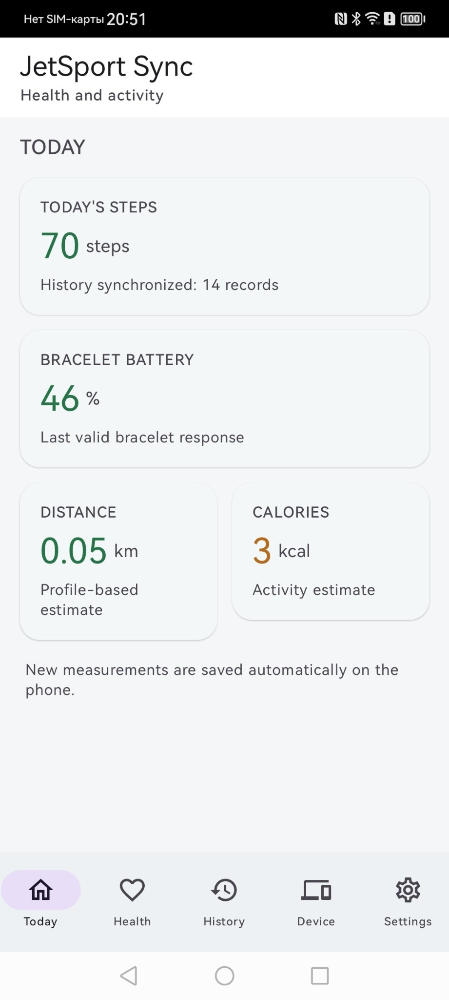
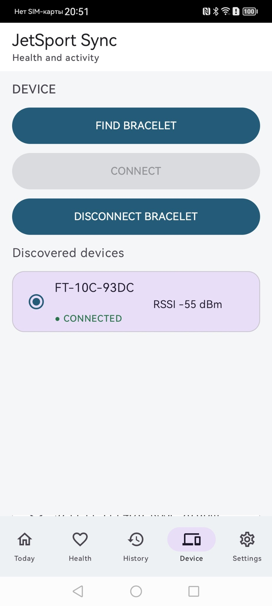
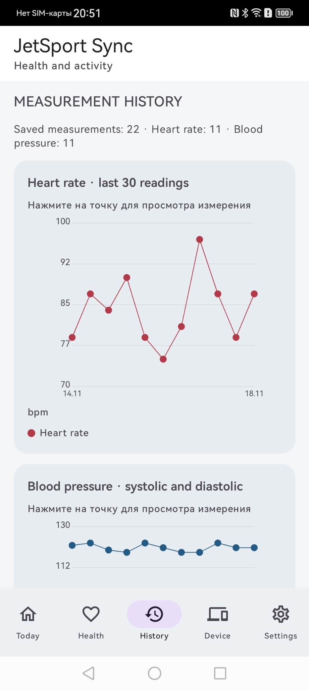

# JetSport FT-10C Sync

An Android application for local BLE communication with the JetSport FT-10C smart bracelet. The project was created to restore basic local synchronization without depending on the manufacturer's unavailable server infrastructure.

## Current status

- Stable checkpoint: **v0.5.3.27** (`gatt-subscription-guard`)
- Tested on: Huawei Nova 10 SE, Android 13
- Target bracelet: JetSport FT-10C
- BLE connection, time synchronization, heart-rate/blood-pressure notifications, history synchronization, battery request, and Bluetooth interruption handling have been user-tested at this checkpoint.
- The app is device-specific; compatibility with other bracelet models is not established.

## Features

- BLE discovery and connection to FT-10C devices
- Local date/time synchronization
- Heart-rate and blood-pressure notification decoding
- Step-history transfer and display
- Battery reading through the FT-10C protocol
- Connection and Bluetooth-state diagnostics
- History and measurements stored locally

SpO2 is not currently implemented. The standard BLE Battery Service value is not considered authoritative for this device; the app uses the FT-10C-specific A2 battery notification/request flow.

## Screenshots

The screenshots below are from the running application. The Device screenshot has been privacy-edited to hide the bracelet's Bluetooth address and unrelated nearby devices.

<table>
  <tr>
    <td align="center"><strong>Today</strong><br></td>
    <td align="center"><strong>Device</strong><br></td>
  </tr>
  <tr>
    <td align="center"><strong>History</strong><br></td>
    <td align="center"><strong>Settings</strong><br></td>
  </tr>
</table>

## Build environment

Open the project root in Android Studio and allow Gradle sync to complete. The project currently uses:

- Android Gradle Plugin 8.5.2
- Kotlin Android plugin 1.9.24
- Java/Kotlin JVM target 17
- compileSdk 35
- targetSdk 35
- minSdk 23

The project archive currently does not include the Gradle Wrapper. Build using an Android Studio installation with a compatible Gradle setup.

## Repository structure

```text
app/
  src/main/java/com/jetsport/ft10csync/
    ble/          BLE scanning, GATT, connection and command coordination
    data/         repositories and technical-log storage
    device/       device profiles and capability registry
    domain/       activity calculations
    presentation/  UI, screen state and view models
    protocol/     notification and history decoding
    sync/         time, battery and history synchronization state
    MainActivity.kt
  src/test/       JVM unit tests
docs/           architecture, protocol notes and screenshots
```

## Documentation

- [Architecture overview](docs/ARCHITECTURE.md)
- [FT-10C protocol notes](docs/FT10C_PROTOCOL.md)
- [Release checklist](docs/RELEASE_CHECKLIST.md)
- [GitHub release guide](docs/GITHUB_RELEASE_GUIDE.md)
- [Contributing](CONTRIBUTING.md)

## Important limitations

- Protocol behavior is documented only to the extent observed or verified during testing. Unknown fields and command details are intentionally marked unknown rather than guessed.
- BLE behavior may differ across Android versions and phone manufacturers.
- The app does not rely on manufacturer cloud services.
- This is an independent project and is not affiliated with JetSport or the bracelet manufacturer.

## License

This project is licensed under the MIT License. See [LICENSE](LICENSE) for details.

## GitHub project policies

- [First commit and GitHub publication guide (Windows)](docs/GITHUB_FIRST_COMMIT.md)
- [Security policy](SECURITY.md)
- [Contributing](CONTRIBUTING.md)
- Bug reports and feature requests use the issue templates in `.github/ISSUE_TEMPLATE/`.
- Releases use `.github/release_template.md` and the release checklist.
